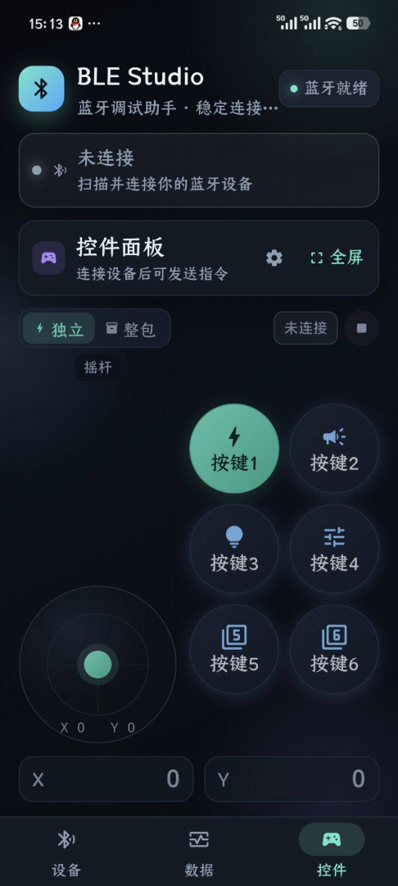
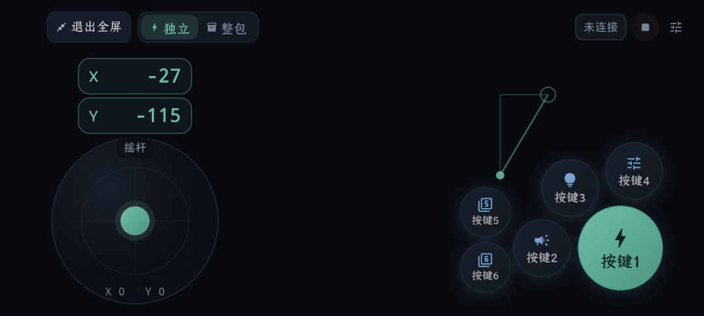
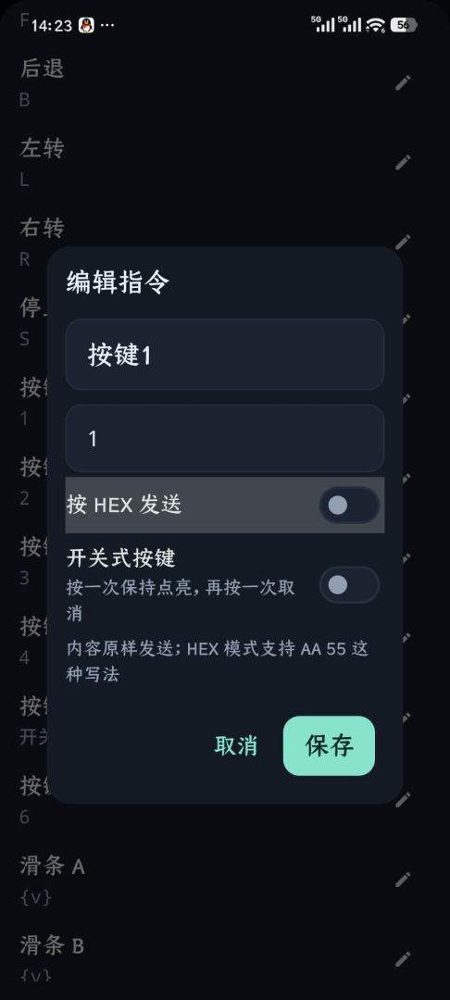

# BLE Studio · 蓝牙调试助手

> 一个给 BLE（低功耗蓝牙）设备用的调试 / 遥控 App：扫描连接、GATT 调试、收发数据、VOFA+ JustFloat 波形，外加一套游戏手柄式的遥控面板。
> 无广告、无联网权限、Android 12 及以上不需要定位权限。

**当前版本**：`v2.2.0`（2026-11-18） · 安装包在 [Releases](../../releases) 里，也可以本地进 `flutter_application_1/` 跑 `python build.py` 自己打。

### 为什么做这个

说白了：市面上的蓝牙调试 App 太难用了。

- **太旧**：不少是几年前的工具，Android 12+ 的蓝牙权限模型（`BLUETOOTH_SCAN` / `BLUETOOTH_CONNECT`）压根没适配，装上要么一直弹授权，要么直接扫不到设备。
- **权限要得太狠**：为了兼容老系统，干脆直接要定位权限，甚至要「始终允许」后台定位。只是连一个自己焊的模块，没必要把位置交出去。
- **又丑又难用**：界面还停留在十年前串口助手的样子，服务列表、收发框、日志挤在一屏；全屏遥控基本没有，调试和遥控往往还得分两个 App。
- **协议靠手抄**：每发一条指令都要自己数字节、抄 UUID，固件改个字段就得重来一遍。

所以这个 App 的目标很朴素：**一个干净、顺手、不要定位权限的 BLE 工具，调完就能直接当遥控器用**——深色界面、控件全部手绘、协议模板在界面上改，换固件不用重新打包。

### 能拿来做什么

- **调设备**：扫描、连接、看服务与特征值，指定 TX / RX，手动读特征值、开关通知，收发 HEX 或文本。
- **看数据**：终端日志按 `TX / RX / ERR / SYS` 着色；设备按 VOFA+ JustFloat 协议发浮点数组就能直接出波形，多通道自动缩放。
- **当遥控器**：左手摇杆 + 右手按键簇 + 空白处搓动，控件都能自定义指令，支持「一控件一包」和「固定结构整包」两种发送模式，页内 / 全屏横屏两套布局。

### 界面一览



**① 控件页（页内布局）**：左侧虚拟摇杆，右侧 2×3 大按键（k1 主键压在右下，拇指落点最短），底部两张卡片实时显示搓动出来的 X / Y；顶部一条工具栏放「独立 / 整包」切换、发送预览和停止键。



**② 全屏横屏（手柄布局）**：按键排成一段弧，左列上方是 X / Y 读数。**没被控件占住的空白都能搓**——图中那条「折线 + 圆点」就是按下点、当前位置和两条直角分量线，位移实时分解成 X（-27）/ Y（-115），松手立即归零。



**③ 逐条自定义指令**：任意控件都能改名称、内容、是否按 HEX 发送，按键还能设成开关式（按一次保持点亮）。改完不用重新打包 App，固件换协议直接改模板即可。

### 和市面上的蓝牙调试 App 比

常见方案是「通用 BLE 调试器（nRF Connect、各类 BLE 助手）+ 遥控器另写一个」，或者「串口助手类 App 只做收发」。BLE Studio 把调试和遥控串在同一条链路上：

| 维度 | 常见蓝牙调试 App | BLE Studio |
| --- | --- | --- |
| 定位 | 通用 GATT 浏览器：看服务、读特征值、发几条指令 | 调试 **+ 遥控** 一体：调试链路和手柄面板是同一个 App、同一条连接 |
| 连接稳定性 | 断线后基本靠手动重连 | 直连失败自动重试 3 次 → 系统级 autoConnect 兜底；断线按 1→2→3→5→8→12→18→25 秒分级重连并恢复通知订阅，另有 12 秒心跳保活 |
| 发指令 | 每次手打 HEX / 文本，协议变了就得重抄 | 控件绑定指令，支持 `{x}` `{y}` `{s1}` `{s2}` `{btn}` 占位符模板；「独立指令」逐条发，「整包」按 20/50/100/200 ms 周期发固定长度包 |
| 遥控操作 | 大多没有手柄，个别只有单个摇杆或几个按钮 | 摇杆（-128~127）+ 弧形键位 + 开关式按键 + **空白处搓动**（位移分解成双轴、反向为负） |
| 数据观察 | 终端日志，个别支持简单绘图 | 终端按 `TX / RX / ERR / SYS` 着色；内建 VOFA+ JustFloat 波形，多通道自动缩放 |
| 权限 / 广告 | 部分内置广告或要定位权限 | 无广告、无联网权限；Android 12+ 不需要定位权限 |
| 体积 | 几十 MB 到上百 MB 不等 | 单一 Release APK，约 49 MB，装了 Flutter 运行时的代价 |
| 局限 | — | 只做 BLE（不支持经典蓝牙 SPP）；波形只认 JustFloat；同时只连一台设备 |

> 一句话：**它不是「功能更多的 nRF Connect」，而是「调试完能直接当遥控器用」的那一个**——协议全在界面上改，换固件不用重新打包。

### 技术栈

| 项 | 说明 |
| --- | --- |
| 框架 | Flutter 3.47（stable）/ Dart 3.13，单 Activity，无第三方 UI 库 |
| 蓝牙 | `flutter_blue_plus 2.3.15`，BLE Central |
| 状态 | `ChangeNotifier` + `AnimatedBuilder`，无额外状态管理依赖 |
| UI | Material 3 + 自定义深色主题（`theme.dart`），控件全部手写绘制（摇杆 / 按键 / 波形 / 搓动轨迹） |
| 测试 | `flutter test`，覆盖整包组包与 JustFloat 解析 |

---

## 1. 功能一览

| 页面 | 能力 |
| --- | --- |
| 设备 | 扫描附近 BLE（12 秒 / 下拉刷新）、名称与 MAC 搜索、信号强度、上次设备置顶重连、连接失败自动重试、断线自动重连、心跳保活；连上后同页展开「服务与特征值」，指定 TX / RX 通道、读特征值、开关通知 |
| 数据 | 顶部切换 **终端 / 波形**：终端显示带 `TX / RX / ERR / SYS` 着色的日志，可复制清空、HEX 收发；波形解析 **VOFA+ JustFloat**，一帧多变量即多通道、可勾选显示哪些变量、双指缩放 / 单指平移、一键自适应、暂停与清空 |
| 控件 | 虚拟摇杆（-128~127）+ 空白处搓动（位移分解成 X / Y，各 -128~127，反向为负，不搓即 0）+ 6 颗按键（k1~k6）+ 停止键；支持 **独立指令** 与 **整包** 两种发送模式；页内紧凑布局、全屏横屏切手柄式弧形键位，逐条自定义指令 |

连接相关默认策略：

- 直连失败自动重试 3 次，仍失败则改用系统级 autoConnect 兜底
- 连上后请求高优先级连接参数 + MTU 517
- 断线后按 1→2→3→5→8→12→18→25 秒逐级自动重连，并恢复之前的通知订阅
- 心跳保活：每 12 秒静默读一次可读特征值，降低空闲断连概率

---

## 2. 环境要求

| 项目 | 版本 / 说明 |
| --- | --- |
| Flutter | 3.47.1（stable），Dart 3.13.1 |
| Android SDK | 需安装 platform-tools、build-tools；compileSdk 跟随 Flutter 配置 |
| JDK | 17（`android/app/build.gradle.kts` 里指定 17） |
| 依赖 | `flutter_blue_plus: 2.3.15` |

首次拉取依赖：

```bash
flutter pub get
```

检查环境是否就绪：

```bash
flutter doctor -v
```

需要看到 Android toolchain 一项为通过（`✓`）。

---

## 3. 打包（生成 APK）

### 方式一：一键脚本（推荐）

工程目录 `flutter_application_1/build.py` 会自动编译、改好名字并打开产物目录（在仓库根执行）：

```bash
cd flutter_application_1
python build.py
```

脚本行为：

0. 先把 `图标.png`（优先工程根，其次上一级目录）转成 `res/mipmap-*/ic_launcher.png` 五档图标，并顺带导出 `图标.ico`；找不到图或没装 Pillow 时打印提示并跳过，不影响打包
1. 读取 `pubspec.yaml` 的版本号（如 `2.0.0+2` → `2.0.0`）
2. 执行 `flutter build apk --release`
3. 把 `build/app/outputs/flutter-apk/app-release.apk` 复制到 `dist/`
4. 命名为 `{APP_NAME}-v{版本}-{日期}.apk`，例如：

```text
dist/BLEStudio-v2.0.0-20261118.apk
```

5. 打印文件大小与原始产物路径，并打开 `dist` 目录

脚本顶部可改的配置：

| 变量 | 作用 | 默认值 |
| --- | --- | --- |
| `APP_NAME` | 产物文件名前缀 | `BLEStudio` |
| `FLUTTER` | flutter 可执行文件路径 | `D:\flutter\bin\flutter.bat` |
| `DIST_DIR` | 产物输出目录 | `dist` |

> 若 `FLUTTER` 指向的路径不存在，脚本会自动改用 PATH 里的 `flutter`。

### 方式二：手动命令

先 `cd flutter_application_1`，再执行：

```bash
# 正式包
flutter build apk --release

# 调试包（可直接 flutter run 安装）
flutter run
```

产物路径（相对 `flutter_application_1/`）：

| 构建类型 | 路径 |
| --- | --- |
| release | `build/app/outputs/flutter-apk/app-release.apk` |
| debug | `build/app/outputs/flutter-apk/app-debug.apk` |

### 安装到手机

```bash
adb install -r flutter_application_1/build/app/outputs/flutter-apk/app-release.apk
```

或直接把 APK 传到手机点击安装（需允许“安装未知来源应用”）。

### 打包常见问题

- **`flutter: command not found`**：把 Flutter 的 `bin` 加入 PATH，或改 `build.py` 里的 `FLUTTER`。
- **Gradle 下载依赖很慢 / 失败**：首次构建需要联网拉 Gradle 与依赖，建议配置国内镜像或代理后重试。
- **`Unsupported class file major version`**：JDK 版本不对，换成 JDK 17。
- **想换启动图标**：替换 `图标.png` 后重新跑 `python build.py`，脚本会自动生成五档 mipmap 并透明化四角黑边（Android 只认 PNG，`.ico` 是给 Windows 端的副产品）。
- **想换应用显示名 / 包名**：改 `android/app/src/main/AndroidManifest.xml` 的 `android:label`，包名改 `android/app/build.gradle.kts` 的 `applicationId`（改包名属于新应用，不能覆盖安装旧版）。
- **正式发布**：目前 release 使用 debug 签名（见 `build.gradle.kts`），上架或分发前需配置自己的 keystore；也可用 `flutter build apk --split-per-abi` 减小体积。

---

## 4. 使用说明

### 设备页

1. 点「扫描」，列表按信号强度排序，上次连过的设备置顶并标记「上次」，按钮直接显示「重连」。
2. 点设备卡片上的「连接」，成功后（默认）自动跳到数据页。
3. 连上后本页出现「服务与特征值」：把可写特征值设为 **TX**，把可通知特征值设为 **RX**，并按需开启通知。
4. 三个开关：自动重连、心跳保活、连上后进数据页。

### 数据页

- **终端**：日志最新在上，行首是时间与方向（`TX` 发送、`RX` 接收、`ERR` 错误、`SYS` 系统），右上角可复制全部 / 清空；底部输入框发送，`HEX` 按钮切换十六进制发送。
- **波形**：设备按 JustFloat 协议发送数据即可自动出图，**一帧里塞几个 float 就是几个通道**，不用预先声明变量个数。

#### 波形视图怎么用

| 操作 | 效果 |
| --- | --- |
| 点底部图例上的 `CH1` / `CH2`… | 单独显示 / 隐藏这个通道 |
| **长按图例**，或点右上角 ☑ 按钮 | 打开「选择通道」面板：勾选要画的变量，带「全选 / 全不选」，等价于 VOFA+ 的右键菜单 |
| **双指捏合** | 缩放：横向改变时间窗（40 ~ 420 帧），纵向同时放大 / 压缩幅值 |
| **单指上下拖** | 纵向平移，配合缩放看局部细节 |
| 点右上角 ⊙ **自适应** | 一键复位到「全部帧 + 自动量程」，也就是刚连上时的默认视图 |
| 暂停 / 清空 | 暂停冻结当前曲线（方便看数值），清空后重新累积 |

波形窗口保留最近 420 帧，满窗后向左滚动；默认 Y 轴按当前可见通道自动缩放，左上角会显示 `帧数 · 通道数 · 当前缩放`。

#### JustFloat 协议格式

每帧 = N 个 **小端 float32**（N 为通道数，1 ~ 8 都能画），帧尾固定 4 字节：

```text
00 00 80 7F
```

示例：两通道，值为 1.5 与 -2.25：

```text
00 00 C0 3F   00 00 10 C0   00 00 80 7F
└─ 1.5 ─────┘ └─ -2.25 ───┘ └─ 帧尾 ────┘
```

四通道（一帧 16 字节 + 帧尾 = 20 字节），依次是 1.0 / -2.0 / 3.5 / 0.25：

```text
00 00 80 3F   00 00 00 C0   00 00 60 40   00 00 80 3E   00 00 80 7F
└─ 1.0 ─────┘ └─ -2.0 ───┘ └─ 3.5 ─────┘ └─ 0.25 ────┘ └─ 帧尾 ────┘
```

要点：

- **通道数由每帧的字节数决定**（`4 × N`），App 按收到的最大通道数画图，帧内多一个 float 就多一条曲线。
- float 必须是 **IEEE-754 小端 32 位**；用 `memcpy` / `struct.pack('<f')` 直接塞原始字节，别做文本化。
- 帧尾 `00 00 80 7F` 是 `+Inf` 的字节形式，**正常数据不会出现**，所以能安全当分隔符。
- 分包 / 粘包都能处理：解析器按字节流找帧尾再回溯 4 的倍数切帧，跨 BLE 包的一帧会自动拼回来。

### 控件页

- **摇杆**：按下即定位、拖动跟手、松手弹簧回中（默认同时发送一次停止指令）；输出 **-128 ~ 127** 的有符号单字节，6% 死区。
- **空白处搓动**：界面上没被控件占住的地方（按键之间的缝、按钮簇四周、摇杆旁边的空白）都能直接搓，相当于游戏里的右手滑屏。
  - **滑动分解**：从按下点到当前位置的位移 `dx / dy` 拆成两个轴，横向 `dx` → X，纵向 `dy` → Y（向上为正向）。
  - **不搓就是 0**：没手指按住时 X = 0、Y = 0；松手瞬间两轴归零并立即补发一次，所以停下就代表「不动」。
  - 位移到空白区域尺寸的约 35% 就走满 **-128 ~ 127**（和摇杆同一量级，反向就是负数），超出只会停在边界。
  - 按住时画面上会出现起点、连线与两条直角分量线，一眼看出这一下被分解成了多少 X / Y。
  - X / Y 走的是 `slider1` / `slider2` 两个通道，底部保留两张卡片实时显示当前值（原来 A / B 滑条的位置）。
- **按键**：k1~k6 共 6 颗；短按立即发一次，**按住 600 ms 后进入持续触发**（每 250 ms 补发一次，独立模式；整包模式按下位置 1、靠周期包生效），松手停止。
- **开关式按键**：k5 默认是开关式——按一次保持点亮、再按一次熄灭，两次都会发一条指令（固件侧按“收到就切换”处理）；其它按键松手即复位。设置里可把任意 k1~k6 改成开关式。
- **按下反馈**：缩放 + 描边提亮 + 从中心扩散的水波 + 触感，松手带一点回弹。
- **布局**：页内（非全屏）是紧凑的 2 列 × 3 行大按键 + 左摇杆，底部两张小卡片显示 X / Y；点「全屏」后横屏进入手柄布局——k1 主键压在右下角，k2~k4 绕它排成一段弧，k5 / k6 在左侧一列，左列上方显示当前 X / Y。搓动始终发生在这些控件之外的空白里，不额外占地方。
- **停止**：摇杆回中 + 搓动轴归零 + 清空按键 + 立即发一次。
- **改指令 / 齿轮设置**：可编辑任意控件的名称、内容、是否按 HEX 发送。按键长按用于持续触发，不再弹编辑；改按键指令走齿轮面板的列表，摇杆标签和 X / Y 读数卡仍可长按直接编辑。

#### 两种发送模式

| 模式 | 说明 |
| --- | --- |
| 独立指令（默认） | 每个按键 / 摇杆 / 搓动轴各自发一包，内容可逐条自定义（搓动轴发的是带符号的 -128~127） |
| 整包 | 把摇杆、搓动 X / Y、按键合成一个固定结构的包，按周期持续发送 |

整包模式默认模板：

```text
AA 55 {x} {y} {s1} {s2} {btn} 55 AA
```

占位符含义：

| 占位符 | 含义 | HEX 模式下的取值 |
| --- | --- | --- |
| `{x}` `{y}` | 摇杆 X / Y | int8，-128~127 **加 128** → 0~255（1 字节） |
| `{s1}` `{s2}` | 搓动 X / Y | int8，-128~127 **加 128** → 0~255（1 字节），**128 = 没搓**，包长不变 |
| `{btn}` | 按键位图 | k1~k6 对应 bit0~bit5（1 字节） |
| `{k1}`~`{k6}` | 单个按键状态 | 0 / 1 |

- 发送周期可选 20 / 50 / 100 / 200 ms
- 模板可切 HEX 或文本（文本模式下数值为十进制字符串）
- 按键按下 / 松开会立即补发一包，不必等周期
- 开关式按键点亮期间，`{btn}` 对应位一直是 1，熄灭才清 0
- 组包失败不会刷屏，只在错误变化时记录一条日志

#### 独立指令模式：怎么解包

每个控件发送的就是它自己那一行 `payload`，原样写到 TX 特征值，没有额外包头：

- **文本模式**：UTF-8 字节。`{x}` `{y}` 换成十进制文本，例如 `{x},{y}` → `-37,96`；`{v}` 换成搓动轴的带符号值（-128~127，0 表示没搓）。
- **HEX 模式**：字面量按十六进制解析，占位符写 **1 字节**，`{x}` 写的是 `x + 128`。

固件侧（HEX 指令 `AA 55 {x} {y} 55 AA`）：

```c
// buf = AA 55 x y 55 AA
if (len == 6 && buf[0] == 0xAA && buf[1] == 0x55 && buf[4] == 0x55 && buf[5] == 0xAA) {
    int8_t x = (int8_t)(buf[2] - 128);   // -128 ~ 127
    int8_t y = (int8_t)(buf[3] - 128);
}
```

#### 整包模式：怎么解包

默认模板共 9 字节：

| 偏移 | 字段 | 类型 | 说明 |
| --- | --- | --- | --- |
| 0 | `0xAA` | 固定包头 | 用来找帧头 |
| 1 | `0x55` | 固定包头 | |
| 2 | `x` | int8 | wire 上是 `x + 128`（0~255） |
| 3 | `y` | int8 | 同上 |
| 4 | `s1` | int8 | 搓动 X，wire 上是 `s1 + 128`（0~255，128 = 没搓） |
| 5 | `s2` | int8 | 搓动 Y，同上 |
| 6 | `btn` | uint8 | 位图，bit0~bit5 = k1~k6 |
| 7 | `0x55` | 固定包尾 | |
| 8 | `0xAA` | 固定包尾 | |

C：

```c
static void on_packet(const uint8_t *b, size_t len) {
    if (len != 9 || b[0] != 0xAA || b[1] != 0x55 || b[7] != 0x55 || b[8] != 0xAA) return;
    int8_t  x  = (int8_t)(b[2] - 128);    // -128 ~ 127
    int8_t  y  = (int8_t)(b[3] - 128);
    int8_t  s1 = (int8_t)(b[4] - 128);    // 搓动 X，-128 ~ 127，0 = 没搓
    int8_t  s2 = (int8_t)(b[5] - 128);    // 搓动 Y
    uint8_t btn = b[6];
    bool k1 = btn & 0x01, k2 = btn & 0x02, k3 = btn & 0x04;
    bool k4 = btn & 0x08, k5 = btn & 0x10, k6 = btn & 0x20;
    // x/y 是归一化到 -128~127 的方向量，按你的电机混控换算即可
}
```

Python：

```python
import struct

def parse(frame: bytes):
    if len(frame) != 9 or frame[0] != 0xAA or frame[1] != 0x55:
        return None
    if frame[7] != 0x55 or frame[8] != 0xAA:
        return None
    x, y, s1, s2 = struct.unpack('bbbb', frame[2:6])   # 全是有符号 int8
    btn = frame[6]
    keys = [(btn >> i) & 1 for i in range(6)]
    return {"x": x, "y": y, "s1": s1, "s2": s2, "keys": keys}
```

文本模板（关掉 HEX）里 `{x}` 直接是 `-128~127` 的十进制文本，`{btn}` 是 0~63 的十进制数，按空格/逗号切分再转数字即可。

#### 省字节的写法

默认模板带 4 字节包头包尾，是为了对齐方便；链路稳定时可以砍：

| 模板 | 字节数 | 说明 |
| --- | --- | --- |
| `AA 55 {x} {y} {s1} {s2} {btn} 55 AA` | 9 | 默认，抗干扰最好 |
| `{x} {y} {s1} {s2} {btn}` | 5 | 去掉包头包尾，靠 BLE 自身的包边界定界 |
| `{x} {y} {btn}` | 3 | 只要方向和按键，搓动量不发 |

- 摇杆用 int8：1 字节/轴；文本模式 `-128` 要 4 字节，HEX 只有 1 字节
- 6 个按键压进 1 字节位图，比 6 个 0/1 字段省 5 字节
- 50 ms 周期 × 5 字节 ≈ 100 B/s，20 ms 周期 ≈ 250 B/s，按需调周期
- 单包不能超过 `MTU - 3`：默认 MTU 23 → 20 字节，协商到 517 后可到 514 字节
- 整包定时发送时内容没变不会重复刷日志（终端里最多约 8 条/秒），实际字节数看顶部 TX 计数

---

## 5. 权限说明

| 权限 | 用途 |
| --- | --- |
| `BLUETOOTH_SCAN`（`neverForLocation`） | Android 12+ 扫描，声明不用于定位，因此**不需要定位权限** |
| `BLUETOOTH_CONNECT` | Android 12+ 连接与读写 |
| `BLUETOOTH` / `BLUETOOTH_ADMIN`（≤ Android 11） | 旧系统蓝牙操作 |
| `ACCESS_FINE_LOCATION`（≤ Android 11） | Android 11 及以下系统扫描 BLE 的强制要求 |

其他说明：

- release 包**不含 INTERNET 权限**，没有任何联网 / 广告 / 统计行为
- debug 包带 INTERNET 权限，仅用于 Flutter 热重载调试
- Android 11 及以下除权限外还需**打开系统定位服务**，否则搜不到设备（系统限制）

---

## 6. 目录结构

```text
README.md                    本文件（仓库根）
图标.png / 图标.ico           应用图标源文件，打包脚本会转成 mipmap
flutter_application_1/      Flutter 工程
├── lib/
│   ├── main.dart            应用外壳：状态横幅、底部导航、生命周期
│   ├── theme.dart           配色与 Material 主题
│   ├── widgets.dart         通用组件（卡片、信号条、渐变按钮、开关胶囊…）
│   ├── ble_controller.dart  扫描 / 连接重试 / 自动重连 / 心跳 / 收发 / 控件状态
│   ├── control_packet.dart  整包模式组包（HEX / 文本模板）
│   ├── wave.dart            JustFloat 解析与波形绘制
│   ├── services_view.dart   服务与特征值区块（并入设备页）
│   └── pages/
│       ├── devices_page.dart  设备页
│       ├── data_page.dart     数据页（终端 / 波形）
│       └── controls_page.dart 控件页（摇杆 / 搓动 / 按键 / 全屏）
├── test/
│   ├── wave_parser_test.dart     JustFloat 解析单测
│   └── control_packet_test.dart  整包组包单测
├── android/                 Android 壳工程（权限、图标、包名）
├── build.py                 一键打包脚本
└── dist/                    打包产物（已 gitignore，不入库）
```

---

## 7. 开发与校验

```bash
flutter analyze          # 静态检查（当前无告警）
flutter test             # 单元测试
flutter run              # 真机调试
flutter run --release    # 真机跑正式包，验证性能
```

真机蓝牙相关功能（扫描、连接、波形）必须用真机测试，模拟器不支持 BLE。

---

## 8. 已知限制

- 单包发送不做自动分包：数据超过 `MTU - 3` 时会明确报错，避免破坏设备协议
- 不保存历史连接（重启 App 后需重新扫描；上次设备仅在本次运行内置顶）
- 未加前台服务，长时间切后台 / 锁屏可能被系统杀掉导致断连
- 波形仅支持 VOFA+ JustFloat，暂不支持 FireWater（文本）协议
- 整包模式 `{x}/{y}` 在 HEX 里按 int8 补码（值 +128）编码，固件需减 128 还原；若你的协议本来就读无符号 0~255，直接当无符号用即可

---

## 9. 更新日志

### v2.2.0 · 2026-11-18

- **波形支持真正的多变量**：一帧里有多少个 float32 就画多少条曲线（1~8 通道），通道数随数据自动增长
- 新增「选择通道」面板：长按图例或点右上角 ☑ 打开，勾选要画的变量，支持全选 / 全不选（对齐 VOFA+ 的右键勾选）
- 新增 **双指缩放**（时间窗 40~420 帧 + 纵向幅值一起缩放）与 **单指上下平移**
- 新增 **自适应按钮**：一键复位时间窗、缩放和平移，回到自动量程
- 左上角状态显示当前帧数 / 通道数 / 缩放倍率
- 补充多通道解析单元测试（4 通道一帧）

### v2.1.3 · 2026-11-18

- README 移到仓库根目录，补上项目介绍、技术栈、更新日志，目录结构与命令按新位置重写
- 加入三张界面截图（`docs/screenshots/`）与「和市面上的蓝牙调试 App 比」对比说明
- 打包产物 `dist/` 加入 `.gitignore`，APK 不再进仓库

### v2.1.2 · 2026-11-18

- **修复搓动轴没有负数**：`updateControls` 曾把轴值夹在 0~100，反向搓会变成 0；现在量程为 **-128 ~ 127**，反向即负
- 整包里的 `{s1}` / `{s2}` 改为和 `{x}` / `{y}` 一致的 **int8 编码**（wire 上 +128 → 0~255），单字节、**包长固定 9 字节**，不再做 `(v+100)/2` 的 0~100 折算
- 文本模式下 `{s1}` / `{s2}` 也输出带符号十进制，与 `{x}` / `{y}` 一致

### v2.1.1 · 2026-11-18

- 遥控面板改为 **空白处搓动**：控件之外的空白都能搓，位移按 `dx / dy` 分解成 X / Y，不搓就是 0 / 0，松手立即归零
- 搓动时显示起点、连线与两条直角分量线，一眼看出这次位移被拆成了多少
- 去掉上一版右侧那整条大方块触控区，布局回归原样
- 底部（原 A / B 滑条位置）改成两张 X / Y 实时读数卡

### v2.1.0 · 2026-11-18

- 滑条 A / B 换成右手触控区，X / Y 双轴输出（初版为 0~100 绝对定位 + 搓动微调）
- 触控通道沿用 `slider1` / `slider2`，整包模式下对应 `{s1}` / `{s2}`

### v2.0.0 · 2026-11-18

- 按键 k5 支持 **开关式**：按一次保持点亮、再按一次熄灭，设置里可把任意按键改成开关式
- k5 / k6 标签由「恢复 / 回城」改为通用编号，命令编辑器新增开关式开关

### v1.0.0 · 2026-11-17

- 首个版本：设备扫描 / 连接 / 自动重连、GATT 调试、终端收发、JustFloat 波形、摇杆 + 6 按键遥控、独立指令与整包两种发送模式
